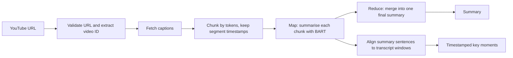

# VidScribe AI

**Turn long YouTube videos into Cornell-style study notes: key moments with clickable timestamps, supporting notes, and a summary.**


<!-- After your first run, save a screenshot as docs/screenshot.png and uncomment the next line:

-->

---

## Table of contents
1. [Overview](#1-overview)
2. [Features](#2-features)
3. [How it works](#3-how-it-works)
4. [Tech stack](#4-tech-stack)
5. [Project structure](#5-project-structure)
6. [Getting started](#6-getting-started)
7. [Summarizer modes](#7-summarizer-modes)
8. [Configuration reference](#8-configuration-reference)
9. [Using the app](#9-using-the-app)
10. [API reference](#10-api-reference)
11. [Error handling](#11-error-handling)
12. [Design decisions](#12-design-decisions)
13. [Security](#13-security)
14. [Testing](#14-testing)
15. [Troubleshooting](#15-troubleshooting)
16. [Limitations](#16-limitations)
17. [Possible improvements](#17-possible-improvements)
18. [License and author](#18-license-and-author)

---

## 1. Overview
Long educational videos are slow to review. VidScribe AI takes a YouTube link, retrieves the video's captions, and produces:

- a concise **AI summary** of the whole video, and
- a set of **key moments**, each tied to a real timestamp in the video and linking straight back to that point.

Summaries are generated with `facebook/bart-large-cnn`. Key moments are grounded in the actual transcript: every timestamp is the real start time of a caption segment, never an estimate.

The interface is a single scrolling page laid out like a **Cornell note-taking sheet**: a cue column of timestamps, a notes column beside it, and a summary box across the bottom.

## 2. Features
- Accepts `youtube.com/watch?v=`, `youtu.be/`, `youtube.com/embed/` and `youtube.com/shorts/` links.
- Uses real captions, preferring English (manual captions before auto-generated) and falling back to YouTube's translation to English.
- Splits long transcripts into token-bounded chunks that never lose their timestamps.
- Map-reduce summarisation with hierarchical reduction, so long videos fit within the model's input limit.
- Transcript-grounded key moments with clickable `HH:MM:SS` timestamps.
- Two summarizer backends: the Hugging Face Inference API, or a local model with no token.
- Retries with exponential backoff for rate limits and temporary service failures, plus hard timeouts.
- Structured JSON errors with meaningful HTTP status codes; no stack traces or secrets reach the browser.
- Process multiple videos without refreshing the page.
- Automated tests that run without network access, a token or a model download.

## 3. How it works



1. **Validate.** The backend checks the URL and extracts the 11-character video ID.
2. **Transcript.** `youtube-transcript-api` fetches the captions. Each segment keeps its text, start time and duration. Sound tags such as `[Music]` are removed, and nothing is ever invented.
3. **Chunk.** Whole segments are grouped into chunks of at most 800 tokens, counted with the real BART tokenizer. Chunks end on sentence boundaries where practical, and a tiny trailing chunk is merged into the previous one.
4. **Map.** Each chunk is summarised by BART. In API mode up to 3 chunks run in parallel; local mode runs one at a time.
5. **Reduce.** Chunk summaries are merged and summarised again. If the merged text is still too long, the reduction repeats level by level (up to 6 levels) until a final pass fits.
6. **Key moments.** For each chunk summary, every sentence is matched against sliding windows of transcript segments (6 segments per window, advancing 3 at a time) using IDF-weighted word overlap. The best-matching window's real start time becomes the timestamp, and the matched transcript excerpt is shown as context. Moments closer than 20 seconds apart are merged, and at most 10 are kept.

> BART only writes the sentences. It does not verify anything about what happens in the video, and the timestamps come from the transcript alone.

## 4. Tech stack

| Technology | Role |
|---|---|
| Python 3.10+ | Backend language |
| FastAPI | HTTP API, request validation, serving the frontend |
| Uvicorn | ASGI server for local runs |
| youtube-transcript-api (1.x) | Captions with timestamps |
| facebook/bart-large-cnn | Abstractive summarisation |
| Hugging Face Inference API (`huggingface_hub`) | Hosted model access (API mode) |
| PyTorch + Transformers | Tokenizer, and local model execution (local mode) |
| python-dotenv | Loads configuration from `.env` |
| HTML5, CSS3, vanilla JavaScript | Single-page interface (no frameworks) |
| pytest, httpx | Tests |

## 5. Project structure

```text
VidScribe-AI/
├── backend/
│   ├── __init__.py
│   ├── app.py                # FastAPI app, POST /process-video, serves the frontend
│   ├── config.py             # All settings and tunables
│   ├── errors.py             # AppError: user-safe errors with codes and HTTP statuses
│   ├── note_generator.py     # Chunking, summarizers, map-reduce, key-moment extraction
│   └── youtube_handler.py    # URL validation and transcript retrieval
├── frontend/
│   ├── dashboard.html        # The single page
│   ├── vidscribe.css         # Cornell-sheet styling (violet palette)
│   ├── vidscribe.js          # Fetch, loading and error states, rendering
│   └── favicon.svg
├── scripts/
│   └── smoke_test.py         # Verifies your chosen summarizer works
├── tests/
│   ├── test_core.py          # URL parsing, timestamps, chunking
│   ├── test_api.py           # End-to-end API with YouTube and the model mocked
│   └── test_backends.py      # Summarizer selection and configuration rules
├── requirements.txt
├── requirements-dev.txt
├── .env.example
├── .gitignore
└── README.md
```

## 6. Getting started

### Prerequisites
- Python 3.10 or newer
- Git
- Either a Hugging Face account with Inference Providers credits (API mode), or enough RAM and disk for the local model (local mode); see [Summarizer modes](#7-summarizer-modes)

### Installation
```bash
git clone https://github.com/vedantmhapsekar06/Vidscribe.git
cd Vidscribe
python -m venv .venv
```
Activate the environment:
```bash
# Windows (PowerShell)
.venv\Scripts\Activate.ps1

# macOS / Linux
source .venv/bin/activate
```
Install dependencies:
```bash
pip install -r requirements.txt
```

> **API mode only?** PyTorch is only needed for local mode and is a large download. You can skip it:
> ```bash
> pip install fastapi "uvicorn[standard]" youtube-transcript-api transformers huggingface-hub requests python-dotenv python-multipart
> ```
> The app then falls back to a word-based token estimate if the tokenizer can't be loaded.

### Configure
```bash
# Windows
copy .env.example .env

# macOS / Linux
cp .env.example .env
```
Open `.env` and set your options (see [Configuration reference](#8-configuration-reference)).

### Verify your setup
```bash
python -m scripts.smoke_test
```
This sends a short sample through your chosen summarizer and prints the result and timing. In local mode the first run downloads the model (about 1.6 GB).

### Run
Always start the server from the **project root**:
```bash
uvicorn backend.app:app --reload
```
Open **http://127.0.0.1:8000**. Interactive API documentation is at **http://127.0.0.1:8000/docs**. Stop the server with `Ctrl+C`.

## 7. Summarizer modes
Choose a backend with `SUMMARIZER_BACKEND` in `.env`:

| Mode | What it does | Requirements |
|---|---|---|
| `hf_api` (default) | Calls `facebook/bart-large-cnn` on the Hugging Face Inference API | `HF_API_TOKEN` and Inference Providers credits. Free accounts have little or no allowance; an HTTP 402 means you need to add credits at huggingface.co/billing |
| `local` | Runs the same model on your machine with PyTorch and Transformers | No token or payment. About 1.6 GB one-time download, roughly 2 GB free disk, and a few GB of RAM. Slower on CPU, much faster on an NVIDIA GPU |

Both modes share the same chunking, map-reduce and key-moment logic. The summary card shows which provider actually produced the result. The model is loaded once and reused between requests in local mode.

## 8. Configuration reference

### Environment variables (`.env`)
| Variable | Default | Description |
|---|---|---|
| `SUMMARIZER_BACKEND` | `hf_api` | `hf_api` or `local` |
| `HF_API_TOKEN` | none | Required only in `hf_api` mode. Create one at huggingface.co/settings/tokens (a fine-grained token needs the "Make calls to Inference Providers" permission) |

Restart Uvicorn after changing `.env`.

### Tunables (`backend/config.py`)
| Setting | Default | Meaning |
|---|---|---|
| `max_chunk_tokens` | 800 | Maximum tokens per transcript chunk (BART accepts 1024) |
| `min_tail_tokens` | 120 | A smaller final chunk is merged into the previous one |
| `min_transcript_tokens` | 50 | Shorter transcripts are rejected |
| `max_chunks` | 60 | Longer videos are rejected |
| `chunk_summary_max` / `_min` | 150 / 40 | Summary length bounds per chunk (tokens) |
| `final_summary_max` / `_min` | 250 / 60 | Final summary length bounds (tokens) |
| `max_reduce_levels` | 6 | Maximum hierarchical reduction passes |
| `max_workers` | 3 | Parallel API requests (local mode always uses 1) |
| `request_timeout` | 60 s | Timeout per API request |
| `max_retries` | 4 | Retries for retryable failures |
| `backoff_base` / `backoff_cap` | 2 s / 20 s | Exponential backoff settings |
| `max_highlights` | 10 | Maximum key moments returned |
| `window_segments` / `window_stride` | 6 / 3 | Transcript window size and step for moment matching |
| `min_highlight_gap_s` | 20 | Minimum spacing between key moments |
| `min_extra_score` | 0.25 | Minimum match score for extra moments from the same chunk |
| `context_chars` | 220 | Length of the transcript excerpt shown with each moment |

## 9. Using the app
1. Open http://127.0.0.1:8000.
2. Paste a YouTube link into the source line at the top of the sheet.
3. Click **Generate notes**. The button is disabled while the request runs, and the sheet shows a spinner with an elapsed-time counter. The progress shown is the real request, not simulated stages.
4. Read the results:
   - **Cue column (left):** clickable timestamps that open the video at that moment.
   - **Notes column (right):** the key point and the transcript excerpt it came from.
   - **Summary box (bottom):** the full summary, the number of transcript sections analysed, and the model and provider used.
5. Paste another link and generate again; no page refresh is needed.

**Works best with:** English-language videos with spoken explanation and captions, such as lectures, tutorials, conference talks and podcasts. Start with a video of 5 to 10 minutes.

## 10. API reference

### `POST /process-video`
Request:
```json
{ "url": "https://www.youtube.com/watch?v=VIDEO_ID" }
```

Success (`200`):
```json
{
  "success": true,
  "video_id": "VIDEO_ID",
  "video_url": "https://www.youtube.com/watch?v=VIDEO_ID",
  "summary": "Generated summary...",
  "highlights": [
    {
      "timestamp": "00:02:14",
      "seconds": 134,
      "text": "Key point written from the chunk summary.",
      "context": "Excerpt of the transcript this was matched to..."
    }
  ],
  "chunks_processed": 4,
  "model": "facebook/bart-large-cnn",
  "provider": "Hugging Face Inference API"
}
```
`provider` is `"Local (Transformers)"` in local mode. Timestamp links are built as `https://www.youtube.com/watch?v=VIDEO_ID&t=SECONDS`.

Error (any non-2xx status):
```json
{ "success": false, "error": { "code": "NO_TRANSCRIPT", "message": "No usable captions were found for this video." } }
```

Example call:
```bash
curl -X POST http://127.0.0.1:8000/process-video \
  -H "Content-Type: application/json" \
  -d '{"url": "https://youtu.be/VIDEO_ID"}'
```

### `GET /`
Serves the web interface. Static assets are served under `/static/`, and interactive API docs under `/docs`.

## 11. Error handling
Every failure returns structured JSON with a user-safe message. Secrets and stack traces are never exposed.

| HTTP | Codes | Meaning |
|---|---|---|
| 400 | `INVALID_URL`, `INVALID_REQUEST` | Not a supported YouTube link, or a malformed request body |
| 404 | `VIDEO_UNAVAILABLE` | Video is private, deleted or unplayable |
| 422 | `CAPTIONS_DISABLED`, `NO_TRANSCRIPT`, `NO_ENGLISH_TRANSCRIPT`, `EMPTY_TRANSCRIPT`, `AGE_RESTRICTED`, `TRANSCRIPT_TOO_SHORT`, `VIDEO_TOO_LONG` | The transcript can't be used. Nothing is fabricated |
| 500 | `CONFIG_ERROR`, `HF_AUTH_ERROR`, `LOCAL_MODEL_UNAVAILABLE`, `LOCAL_MODEL_LOAD_FAILED`, `INTERNAL_ERROR` | Server configuration or unexpected problem |
| 502 | `UPSTREAM_ERROR`, `MODEL_UNAVAILABLE`, `EMPTY_RESPONSE`, `SUMMARIZATION_FAILED`, `TRANSCRIPT_ERROR` | Hugging Face or YouTube problem |
| 503 | `HF_QUOTA`, `RATE_LIMITED`, `MODEL_LOADING`, `YOUTUBE_BLOCKED` | Out of credits, rate limited, model loading, or YouTube blocking requests |
| 504 | `HF_TIMEOUT` | The summarization service timed out |

Rate limits (429), model loading (503), temporary upstream errors (5xx) and a first timeout are retried with exponential backoff. An empty model response is treated as a failure, never replaced with a placeholder.

## 12. Design decisions
- **Tokenizer-based chunking.** Chunk sizes are measured with the real BART tokenizer so requests stay within the model limit, and chunks are built from whole segments so every highlight can be traced to a timestamp.
- **Hierarchical reduce.** A single merge pass would overflow the model on long videos, so the reduction repeats until the combined text fits.
- **Grounded highlights.** BART is abstractive and cannot pick moments on its own. Highlights are found by aligning generated sentences to transcript windows, so the timestamp is always a real caption start time and a transcript excerpt is shown as evidence.
- **Two backends behind one interface.** The pipeline only needs "text in, summary out", so the API and local summarizers are interchangeable and selected with one setting.
- **Honest loading state.** One request can't report real stages, so the UI shows an elapsed-time counter instead of fake step messages.
- **Config-driven code.** Tunables live in `backend/config.py` rather than being scattered as constants.

## 13. Security
- The Hugging Face token stays on the server. It is never returned in a response or exposed to browser JavaScript.
- `.env` is listed in `.gitignore`. Only `.env.example` with a placeholder is committed.
- The frontend inserts all backend text with `textContent`, never `innerHTML`, so transcript content can't inject markup.
- Timestamp links are built only from the validated 11-character video ID and an integer number of seconds.
- CORS is limited to the local origins.
- If a token is ever committed by accident, revoke it immediately at huggingface.co/settings/tokens. Removing it from git history is not enough.

## 14. Testing
```bash
pip install -r requirements-dev.txt
python -m pytest
```
The 20 tests cover URL parsing, timestamp formatting, chunking, the full API flow, error responses, static assets and summarizer selection. They mock YouTube and the summarizers, so they need no network, token or model download.

## 15. Troubleshooting

| Symptom | Cause and fix |
|---|---|
| `HF_QUOTA` / HTTP 402 | Your Hugging Face account has no Inference Providers credits. Add credits at huggingface.co/billing, or use `SUMMARIZER_BACKEND=local` |
| `HF_AUTH_ERROR` | Token is invalid, or a fine-grained token lacks the Inference Providers permission |
| `CONFIG_ERROR` | In `hf_api` mode `HF_API_TOKEN` is empty, or `SUMMARIZER_BACKEND` has an unknown value. Restart Uvicorn after editing `.env` |
| `MODEL_UNAVAILABLE` | The hosted model isn't served to your account right now. Run the smoke test to confirm |
| `MODEL_LOADING` / `RATE_LIMITED` | Temporary. The server retries with backoff, then asks you to try again |
| `YOUTUBE_BLOCKED` | YouTube blocks transcript requests from some cloud and VPN IP addresses. A normal home connection usually works |
| `NO_TRANSCRIPT` / `CAPTIONS_DISABLED` | The video has no usable captions |
| `LOCAL_MODEL_UNAVAILABLE` | PyTorch or Transformers isn't installed in the active environment. Re-run `pip install -r requirements.txt` |
| `LOCAL_MODEL_LOAD_FAILED` | The first local run couldn't download the model. Check your internet connection and free disk space (about 2 GB) |
| Local mode is slow | CPU inference takes several seconds per chunk, and the first request also loads the model |
| Page looks outdated after an update | Hard-refresh with Ctrl+F5 to clear the cached CSS and JavaScript |
| `uvicorn` isn't recognised | The virtual environment isn't active. Run the activate command again |
| PowerShell blocks activation | Run `Set-ExecutionPolicy -Scope CurrentUser RemoteSigned` once, or use Command Prompt |

## 16. Limitations
- Quality depends on captions. Auto-generated captions are noisier and produce weaker notes.
- BART is English-only. Other languages work only if YouTube can translate the captions to English.
- Videos longer than about 60 chunks are rejected to keep requests reasonable.
- Highlights are chosen by text similarity between generated sentences and the transcript, so they are useful pointers, not a verified list of the video's most important events.
- API mode is limited by your Hugging Face credits; local mode is limited by your hardware.
- Summaries are generated by a model and may contain inaccuracies.

## 17. Possible improvements
- Cache results by video ID to avoid repeating work
- Export notes as Markdown or PDF
- Stream real per-stage progress to the page
- Docker image for one-command setup
- Support for additional summarization models and languages
- Deployment with a proxy for YouTube transcript requests

## 18. License and author
Released under the MIT License. Add a `LICENSE` file to the repository to make this official.

Built by [@vedantmhapsekar06](https://github.com/vedantmhapsekar06).
