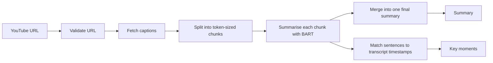

# VidScribe AI

Turn long YouTube videos into Cornell-style study notes: key moments with clickable timestamps, supporting notes and a summary.

## Overview

Long educational videos are slow to review. VidScribe AI takes a YouTube link, fetches the video's captions, and produces:

- an **AI-generated summary** of the whole video, and
- a set of **key moments**, each linked to a real timestamp in the video.

Summaries are generated with `facebook/bart-large-cnn`. Every timestamp is the real start time of a caption segment from the transcript, never an estimate. The interface is a single scrolling page laid out like a Cornell note-taking sheet.

## Dashboard

**Landing page**


**Generated notes**


## How it works



1. **Validate.** The backend checks the link and extracts the video ID.
2. **Transcript.** The captions are fetched with their start times. English is preferred, and nothing is invented.
3. **Chunk.** The transcript is split into chunks that fit BART's input limit, keeping each segment's timestamp.
4. **Map.** Each chunk is summarised by BART.
5. **Reduce.** The chunk summaries are merged and summarised again until one coherent summary remains.
6. **Key moments.** Each summary sentence is matched to the transcript passage it best fits, and that passage's real start time becomes the timestamp. BART only writes the sentences; it does not verify anything about the video.

## Tech stack

| Technology | Role |
|---|---|
| Python | Backend language |
| FastAPI | API and serving the frontend |
| Uvicorn | Local server |
| YouTube Transcript API | Captions with timestamps |
| facebook/bart-large-cnn | Summarisation model |
| Hugging Face Inference API | Hosted model access |
| Transformers, PyTorch | Tokenizer and optional local model |
| python-dotenv | Configuration from `.env` |
| HTML, CSS, vanilla JavaScript | Single-page interface |
| pytest | Tests |

## Project structure

```text
VidScribe-AI/
├── backend/
│   ├── app.py                # FastAPI app and POST /process-video
│   ├── config.py             # Settings and tunables
│   ├── errors.py             # User-safe errors
│   ├── note_generator.py     # Chunking, summarisation, key moments
│   └── youtube_handler.py    # URL validation and transcripts
├── frontend/
│   ├── dashboard.html        # The single page
│   ├── vidscribe.css         # Styling
│   ├── vidscribe.js          # Requests and rendering
│   └── favicon.svg
├── scripts/
│   └── smoke_test.py         # Checks your summarizer works
├── tests/                    # Automated tests
├── docs/screenshots/         # README images
├── requirements.txt
├── requirements-dev.txt
├── .env.example
└── README.md
```

## Setup and run

**Requirements:** Python 3.10 or newer, and Git.

**1. Clone and create a virtual environment**

```bash
git clone https://github.com/vedantmhapsekar06/Vidscribe.git
cd Vidscribe
python -m venv .venv
```

Activate it:

```bash
# Windows (PowerShell)
.venv\Scripts\Activate.ps1

# macOS / Linux
source .venv/bin/activate
```

**2. Install dependencies**

```bash
pip install -r requirements.txt
```

**3. Configure**

```bash
# Windows
copy .env.example .env

# macOS / Linux
cp .env.example .env
```

Open `.env` and choose how summaries are generated:

| Setting | Meaning |
|---|---|
| `SUMMARIZER_BACKEND=hf_api` | Uses the Hugging Face Inference API. Needs `HF_API_TOKEN` from huggingface.co/settings/tokens and Inference Providers credits. |
| `SUMMARIZER_BACKEND=local` | Runs BART on your own machine. No token or payment, but it downloads about 1.6 GB and needs a few GB of RAM. |

**4. Check your setup**

```bash
python -m scripts.smoke_test
```

**5. Start the app** from the project root

```bash
uvicorn backend.app:app --reload
```

Open **http://127.0.0.1:8000**, paste a YouTube link that has captions, and click **Generate notes**. Press `Ctrl+C` to stop the server.

**Optional: run the tests**

```bash
pip install -r requirements-dev.txt
python -m pytest
```

## Limitations

- Results depend on the video having captions. Auto-generated captions are noisier and give weaker notes.
- BART is English-only. Other languages work only if YouTube can translate the captions to English.
- Very long videos (about 60 chunks or more) are rejected to keep requests reasonable.
- Key moments are chosen by text similarity to the transcript, so they are useful pointers, not a verified list of the video's most important events.
- API mode needs Hugging Face credits, and local mode needs enough RAM and disk space.
- Summaries are model-generated and may contain inaccuracies.
- YouTube can block transcript requests from some VPN and cloud IP addresses.

## Author

**Vedant Mhapsekar**
GitHub: [@vedantmhapsekar06](https://github.com/vedantmhapsekar06)
